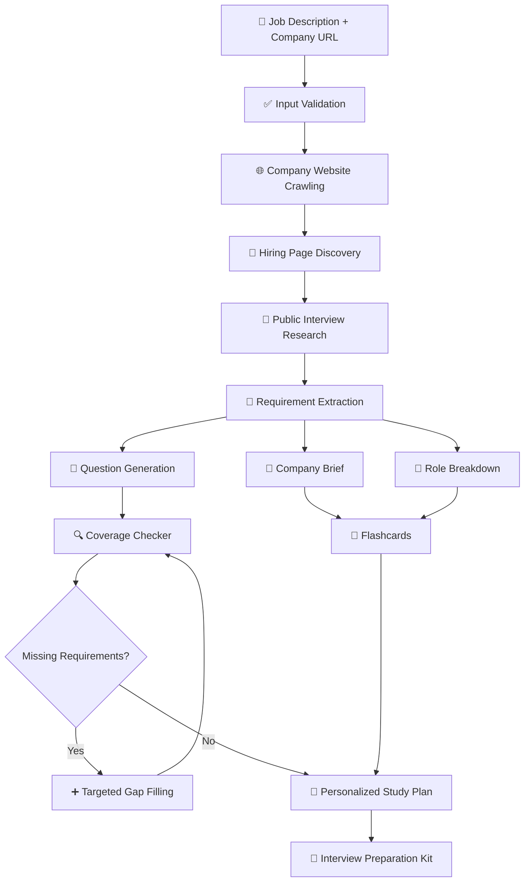
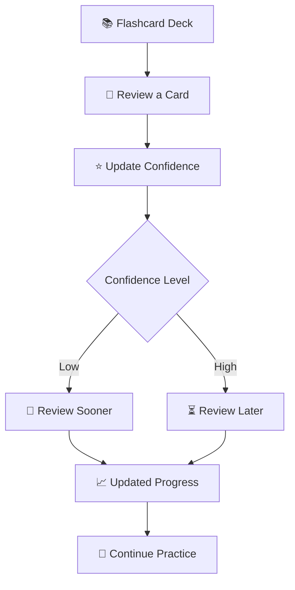
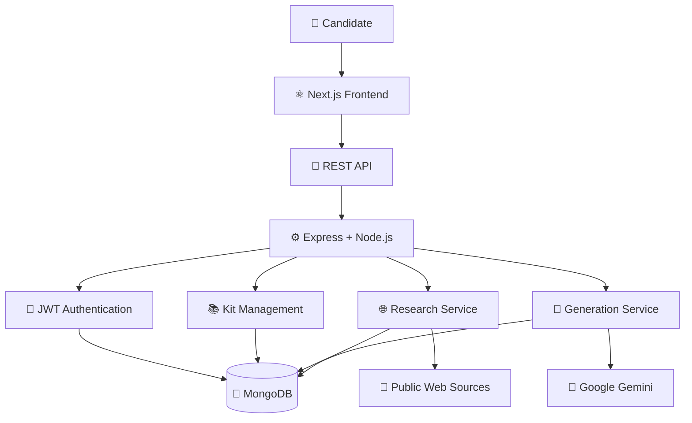

# 🚀 Interview Prep Kit — AI-Powered Interview Preparation

<p align="center">
  
</p>

<p align="center">
  
</p>

<p align="center">
  
  
  
  
  
</p>

<p align="center">
  
  
  
  
</p>

<p align="center">
  <strong>Transform a job description and company URL into a personalized interview preparation kit — with company research, targeted questions, smart flashcards, and a structured study plan.</strong>
</p>

<p align="center">
  <a href="#-overview">Overview</a> •
  <a href="#-features">Features</a> •
  <a href="#-ai-pipeline">AI Pipeline</a> •
  <a href="#-architecture">Architecture</a> •
  <a href="#-installation">Installation</a> •
  <a href="#-roadmap">Roadmap</a>
</p>

---

## 🌌 Overview

**Interview Prep Kit** is an AI-powered full-stack platform that helps candidates prepare for a specific job opportunity instead of relying only on generic interview questions.

Provide a job description and company URL. The application researches relevant company information, analyzes role requirements, generates targeted interview questions, builds flashcards, checks topic coverage, and organizes preparation into a personalized schedule.

### ✨ The Preparation Experience

<table>
<tr>
<td width="33%" align="center">

### 📄 Analyze

Extract skills, requirements, and responsibilities from a job description.

</td>
<td width="33%" align="center">

### 🧠 Generate

Create targeted technical, behavioral, and system-design questions.

</td>
<td width="33%" align="center">

### 🎯 Practice

Review flashcards, strengthen weak areas, and follow a study schedule.

</td>
</tr>
</table>

---

## 🚀 Features

### 📄 1. Job Description Analyzer

- Extracts skills and technical requirements
- Identifies responsibilities and role information
- Organizes requirements for interview preparation
- Uses the job description to guide question generation

### 🏢 2. Company Intelligence

- Crawls relevant company website pages
- Discovers careers and hiring-related pages
- Collects relevant public company information
- Researches publicly accessible interview discussions
- Handles unavailable pages and incomplete research gracefully

### 🎯 3. AI Question Generation

Generate preparation material tailored to the opportunity:

- Technical interview questions
- Behavioral interview questions
- System-design questions
- Company-fit questions
- Questions mapped to required skills

### 🎴 4. Smart Flashcards

- Review generated preparation material
- Track confidence levels
- Prioritize weaker topics
- Adjust future review intervals based on confidence and review history

### 📅 5. Personalized Study Planner

- Organizes preparation into a day-by-day plan
- Distributes material across available preparation days
- Supports structured, focused practice
- Helps candidates plan their time before an interview

### 🔍 6. Requirement Coverage Checker

The application evaluates whether generated questions address the skills identified in the job description.

- Maps questions to requirements
- Detects missing topic coverage
- Generates additional questions for uncovered skills
- Rechecks coverage before finalizing the preparation kit
- Supports up to three coverage passes

### ✏️ 7. Editable and Pinned Content

Your preparation work should remain yours.

| Content state | Behavior |
|---|---|
| `generated` | AI-generated content may be replaced during regeneration |
| `edited` | User modifications are preserved |
| `pinned` | Important content is protected from regeneration |

This state-management behavior applies to questions, flashcards, and requirements as documented by the project.

### 🔐 8. Authentication

- JWT-based authentication
- User-specific preparation kits
- Protected application routes
- Backend authentication middleware

### ⚡ 9. Reliable AI and Research Processing

- Retry and fallback handling for invalid AI output
- Rate-limit handling with exponential backoff
- `robots.txt`-aware website crawling
- Graceful degradation when company research fails
- Deterministic study-schedule allocation

---

## 🎬 Animated Project Showcase

<p align="center">
  
</p>

<table>
<tr>
<td width="50%" align="center">

### 🔍 Company Research

Discover relevant company and hiring information.

</td>
<td width="50%" align="center">

### 🧠 Question Bank

Build a targeted set of interview questions.

</td>
</tr>
<tr>
<td width="50%" align="center">

### 🎴 Flashcard Practice

Prioritize weaker topics with confidence-based reviews.

</td>
<td width="50%" align="center">

### 📅 Study Planner

Turn preparation material into a structured schedule.

</td>
</tr>
</table>

> Add real screenshots or a GIF from the running application to showcase the actual interface.

---

## 🔄 AI Preparation Pipeline

Interview Prep Kit uses a multi-stage workflow rather than relying on a single large AI prompt.



### Why a Multi-Stage Pipeline?

- Research and generation are separated into distinct stages.
- Questions are tied to extracted job requirements.
- Coverage checks help identify missing topics.
- Gap filling generates additional material when necessary.
- Failure handling reduces the impact of unavailable research sources or invalid AI output.

---

## 💎 Smart Coverage System

Generating questions is only part of interview preparation. The application also checks whether the question bank covers the role's requirements.

```text
          📋 ROLE REQUIREMENTS
                   │
                   ▼
          🧠 GENERATED QUESTIONS
                   │
                   ▼
           🔗 REQUIREMENT MAPPING
                   │
                   ▼
            📊 COVERAGE CHECK
                   │
             ┌─────┴─────┐
             ▼           ▼
        ✅ Covered   ❌ Missing
                         │
                         ▼
                  ➕ Gap Filling
                         │
                         ▼
                    🔄 Recheck
                         │
                         ▼
                  🎯 Better Coverage
```

The pipeline supports up to **three coverage passes** before finalizing the preparation kit.

---

## 🎴 Confidence-Weighted Flashcards

Practice should focus on the topics that need the most improvement.



The documented practice workflow sorts cards by confidence, updates confidence after review, and determines future review intervals using confidence and review history.

---

## ✏️ Content Preservation During Regeneration

AI regeneration should not erase useful manual improvements.

```text
                🤖 AI CONTENT
                     │
           ┌─────────┼─────────┐
           ▼         ▼         ▼
       Generated   Edited    Pinned
           │         │         │
           ▼         ▼         ▼
       May Replace  Preserve  Protect
       on Refresh   Changes   Content
```

This allows candidates to refine answers, preserve useful questions, and regenerate other content without losing their work.

---

## 🏗️ System Architecture



### Architecture Layers

| Layer | Responsibility |
|---|---|
| Frontend | Authentication, kit list, kit builder, and practice interface |
| REST API | Communication between frontend and backend |
| Express backend | Routing and application logic |
| Authentication | JWT-based user verification |
| Research service | Company crawling and hiring-page discovery |
| Generation service | AI-generated questions and preparation material |
| MongoDB | Persistent user and preparation-kit data |
| Gemini | Language-model generation |

---

## 🧰 Technology Stack

### Frontend

<p align="center">
  
</p>

- Next.js 14
- TypeScript
- Tailwind CSS
- Zustand

### Backend

<p align="center">
  
</p>

- Node.js
- Express.js
- TypeScript
- JWT authentication

### Database

<p align="center">
  
</p>

- MongoDB
- Mongoose

### AI and Web Research

<p align="center">
  
  
  
</p>

- Google Gemini 1.5 Flash
- Cheerio
- `node-fetch`
- `robots-parser`
- DuckDuckGo search

---

## 🔐 Reliability and Engineering

| Engineering Feature | Purpose |
|---|---|
| Multi-stage AI pipeline | Separates research, extraction, generation, and validation |
| Coverage validation | Identifies missing requirement coverage |
| Gap filling | Creates additional questions for uncovered skills |
| Confidence-based reviews | Prioritizes weaker flashcard topics |
| Content-state management | Protects edited and pinned material |
| `robots.txt`-aware crawling | Respects applicable crawler rules |
| Exponential backoff | Handles rate limits and temporary failures |
| Graceful degradation | Allows preparation to continue when research fails |
| Deterministic scheduling | Allocates preparation material consistently |
| AI output recovery | Retries or falls back when generated output is invalid |

---

## 💻 Installation

### Prerequisites

- Node.js
- npm
- MongoDB or MongoDB Atlas
- Google Gemini API key
- Git

### 1. Clone the Repository

```bash
git clone <your-existing-repository-url>
cd interview-prep-kit
```

Keep your existing repository URL unchanged when replacing this placeholder.

### 2. Install Dependencies

From the project root:

```bash
npm run install:all
```

### 3. Configure Environment Variables

Copy the backend example environment file:

```bash
cp backend/.env.example backend/.env
```

On Windows Command Prompt, use:

```cmd
copy backend\.env.example backend\.env
```

Configure the required MongoDB connection string, JWT secret, Gemini API key, and other variables expected by your backend.

Example configuration:

```env
PORT=3001
NODE_ENV=development
MONGODB_URI=your_mongodb_connection_string
JWT_SECRET=replace_with_a_secure_random_secret
FRONTEND_URL=http://localhost:3000
GEMINI_API_KEY=your_gemini_api_key
```

These are illustrative values. Follow the exact variable names in `backend/.env.example` and your application code.

**Do not commit `.env` files, database credentials, or API keys.**

### 4. Start the Application

```bash
npm run dev
```

### 5. Open the Application

| Service | Local URL |
|---|---|
| Frontend | `http://localhost:3000` |
| Backend | `http://localhost:3001` |
| Health check | `http://localhost:3001/api/health` |

---

## 📸 Screenshots


### 🏠 Homepage

<p align="center">
  
</p>

### 📄 Job Description Analysis

<p align="center">
  
</p>

### 🧠 Interview Question Bank

<p align="center">
  
</p>

### 🎴 Smart Flashcards

<p align="center">
  
</p>

### 📅 Personalized Study Plan

<p align="center">
  
</p>

---

## 🛣️ Roadmap

### ✅ Implemented Capabilities

- [x] Job description analysis
- [x] Company website crawling
- [x] Hiring page discovery
- [x] Public interview discussion research
- [x] AI question generation
- [x] Smart flashcards
- [x] Requirement coverage validation
- [x] Gap filling
- [x] Personalized study schedules
- [x] Confidence-based practice
- [x] Editable and pinned content

### 🔮 Future Enhancements

- [ ] 🎤 AI mock interviews
- [ ] 🗣️ Voice-based interview practice
- [ ] 📈 Interview performance analytics
- [ ] ☁️ Cloud-synced practice progress
- [ ] 📱 Mobile application
- [ ] 📧 Interview reminder notifications
- [ ] 📊 Company-specific preparation analytics
- [ ] 🤖 Adaptive difficulty levels
- [ ] 🧑‍💻 Coding-round practice integration

---

## 🧠 What This Project Demonstrates

| Area | Skills Demonstrated |
|---|---|
| Frontend | Next.js, TypeScript, Tailwind CSS |
| Backend | Node.js, Express, REST APIs |
| Database | MongoDB, Mongoose |
| Authentication | JWT |
| AI integration | Gemini-powered content generation |
| Web research | Crawling, parsing, hiring-page discovery |
| Algorithms | Requirement mapping and coverage validation |
| Study systems | Confidence-weighted flashcards and scheduling |
| Reliability | Retry, fallback, rate-limit handling |
| State management | Preserving edited and pinned content |

---

## 🎯 Project Vision

> **Don't prepare for just any interview. Prepare for *this interview*.**

Interview Prep Kit connects the requirements of a specific job opportunity with company research, targeted questions, smart practice, and a personalized preparation schedule.

**Paste the JD. Add the company. Start preparing. 🚀**

---

## 👨‍💻 Developer

**Dhanush Gopi Kavala**

Full-Stack Developer | Software Engineering Graduate

<p align="center">
  <a href="https://github.com/dhanushgopi2456">
    
  </a>
  <a href="https://www.linkedin.com/in/dhanush-gopi-kavala-a460a528b/">
    
  </a>
</p>

---

<p align="center">
  
</p>

<p align="center">
  <strong>🚀 Research. Prepare. Practice. Succeed.</strong><br/>
  <em>Interview Prep Kit — Your next interview, better prepared.</em>
</p>

<p align="center">
  ⭐ If you find this project useful, consider starring the repository!
</p>
